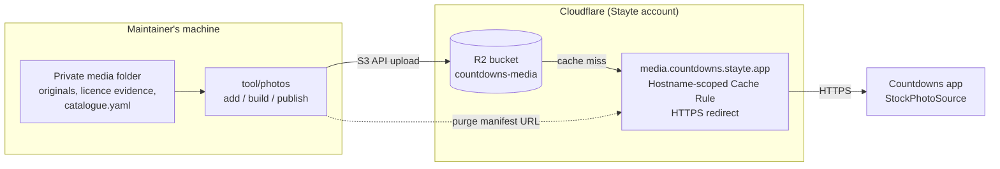

# Stock photo catalogue on Cloudflare: implementation plan

Status: Cloudflare delivery, scoped credentials and publisher are configured and verified. The live version-1 catalog is empty with `enabled: false` until photos are curated. Publisher code lives under `tool/photos/`; content sourcing remains a separate step. Lives at `design/photo-catalogue/PLAN.md`.

This repository is public. Nothing private goes into it: no API tokens, account IDs, access keys, original photo files, licence evidence, model releases or contracts. See [What never goes in the repo](#what-never-goes-in-the-repo).

## Summary

Countdowns serves its own stock background photos from Cloudflare R2. They are served as static files on `media.countdowns.stayte.app`, behind Cloudflare's cache. There is no database and no server code in v1.

- **Where:** the Stayte Cloudflare account. One R2 bucket, `countdowns-media`, with the custom domain `media.countdowns.stayte.app`.
- **What:** one JSON manifest plus photos that are already resized and compressed. A local publish script makes the files and uploads them.
- **Image optimization happens at upload, never on the fly.** Cloudflare Images transformations and Polish stay off for this hostname. Every size is made by the publish script and stored in R2.
- **The app:** one new `StockPhotoSource` implementation in `lib/stock/`, plus a one-line swap in `lib/stock/stock_provider.dart`. Categories, seasonal order and title keywords stay in the app.
- **Cost:** likely $0 a month at current scale. R2 has no egress fees and the cache absorbs most reads.

## Why

- Pexels has paused new API keys.
- The Pixabay and Unsplash terms are not acceptable for this app.
- None of the three licences allow re-hosting their photos as a collection. So this catalogue holds only photos we own, commissioned work, or true CC0 and public-domain images.

## Architecture



- The app only ever talks to `media.countdowns.stayte.app`. It never uses an R2 or `r2.dev` URL.
- Photo files have content-hashed names and never change, so they are cached for a year.
- The manifest is cached for 5 minutes and purged on every publish.
- **Later, only if needed:** a Worker on `/catalog/*` that reads the same bucket, with D1 or KV. It serves the same JSON at the same URL, so the app class barely changes. Reasons to add one: server-side search, per-country manifests, or an admin site.

## Cloudflare setup (Stayte account)

Do these in the Stayte account. The domain must be a zone in the same account as the bucket.

1. **Check the zone.** Confirm `stayte.app` is a zone in the Stayte account. If it is not, add it, or set up `countdowns.stayte.app` as its own zone.
2. **Create the R2 bucket** `countdowns-media` with the Standard storage class. Choose a location hint close to most users, or leave it automatic.
3. **Connect the custom domain.** Under the bucket's Settings, add `media.countdowns.stayte.app` as a Custom Domain. Wait for the status to become Active.
4. **Turn off `r2.dev` public access.** It is rate limited, it is meant for development only, and it bypasses the cache and WAF.
5. **Add a Cache Rule.** JSON is not cached by default.
   - When: hostname equals `media.countdowns.stayte.app` and the URI path starts with `/catalog/` or `/p/`.
   - Then: eligible for cache, respecting the uploaded object's `Cache-Control` for edge and browser caching. HTTP 400–599 responses are not cached.
6. **Leave Smart Tiered Cache off.** It is a zone-wide setting; the approved setup isolates delivery changes to the media hostname and uses ordinary CDN caching.
7. **Defer the rate-limiting rule.** The current Free plan cannot match the hostname in a rate-limit rule. Do not add a broader rule that affects other `stayte.app` hosts. Revisit separately if needed.
8. **Leave these off for this hostname:** Image Transformations, Polish and Mirage. Images are optimized at upload. Test Bot Fight Mode before enabling it, because its challenges can block the app's plain HTTP requests.
9. **Keep the existing $10 account-wide budget notification.** It includes R2 usage-based charges. It is an alert, not a hard spending cap; R2 does not offer a hard cap.
10. **Create two API tokens.** Keep them outside the repo (see below).
    - An R2 token with Object Read & Write on `countdowns-media` only. The publish script uses it through the S3 API.
    - An API token with Cache Purge on the zone. The publish script uses it to purge the manifest URL.

## Bucket layout

```text
countdowns-media/
  catalog/v1/manifest.json          Cache-Control: public, max-age=300
  catalog/v1/manifest-<N>.json      Cache-Control: public, max-age=31536000, immutable
  p/<photoId>/<hash8>.thumb.webp    Cache-Control: public, max-age=31536000, immutable
  p/<photoId>/<hash8>.full.jpg      Cache-Control: public, max-age=31536000, immutable
```

- `<hash8>` is the first 8 hex characters of the SHA-256 of the output file. If a photo is re-edited, it gets new paths. Objects are never overwritten in place, except `manifest.json`.
- `manifest-<N>.json` keeps every published version, so a rollback is a copy.
- Content types: `image/webp`, `image/jpeg`, and `application/json; charset=utf-8`.

## Image sizes (made at upload)

| Size | Long edge | Format | Target size | Used for |
| --- | --- | --- | --- | --- |
| `thumb` | 480 px | WebP, quality about 70 | 25 to 40 KB | Photos grid on phone and tablet |
| `full` | 2560 px | JPEG, quality about 82, progressive | 600 to 900 KB | Downloaded on pick and stored like a camera roll photo |

- `full` stays JPEG because it becomes a normal app photo. The crop screen and the native widget code (SwiftUI and Kotlin) read it.
- Before resizing, the script applies EXIF orientation, converts to sRGB, then strips all metadata, including GPS.
- It never upscales. A photo whose source is smaller than 2560 px on its long edge is rejected, unless a `--allow-small` flag is passed.
- It computes the average colour, which the app uses as a placeholder, from the `thumb`.
- It also generates a standard 4×3 BlurHash from a small RGBA decode of the processed thumbnail and writes the optional lowercase `blurhash` field on every published photo. The app already reads this field.
- Suggested tool: Node with `sharp` (libvips), for good WebP and JPEG encoders. A Dart CLI that shells out to `vips` is also fine. The Dart `image` package is not suitable, because it does not encode WebP well.
- A third `preview` size (1280 px WebP) can be added later if the app gets a full-screen preview before picking.

## Manifest

The manifest is public, so it holds only public fields: no licence evidence, private notes or file paths.

```json
{
  "schema": 1,
  "version": 42,
  "generatedAt": "2026-11-22T14:00:00Z",
  "baseUrl": "https://media.countdowns.stayte.app/",
  "enabled": true,
  "categories": {
    "christmas": { "cover": "p_0412" }
  },
  "photos": [
    {
      "id": "p_0412",
      "categories": ["christmas", "winter"],
      "w": 1707,
      "h": 2560,
      "color": "#7A4E3B",
      "blurhash": "LEHV6nWB2yk8pyo0adR*.7kCMdnj",
      "focal": { "x": 0.5, "y": 0.35 },
      "files": {
        "thumb": "p/p_0412/3f9a1c2e.thumb.webp",
        "full": "p/p_0412/8b10d7aa.full.jpg"
      },
      "credit": {
        "name": "Photographer Name",
        "url": "https://example.com/photographer",
        "page": "https://example.com/source-page"
      },
      "license": "CC0-1.0",
      "tags": ["tree", "lights", "snow"],
      "added": "2026-11-22",
      "hidden": false
    }
  ]
}
```

| Field | Notes |
| --- | --- |
| `schema` | The app ignores a manifest whose schema it doesn't know, and keeps its cached copy. |
| `version` | Goes up by one on every publish. It is also `N` in the snapshot file name. |
| `baseUrl` | Every file path is relative to this, so the host can change without an app release. |
| `enabled` | Kill switch. When false, the app hides stock photos and offers the camera roll only. |
| `categories` | Optional overrides only, such as a cover photo. Ids are the app's own category ids. The app owns the list, the seasonal order and the keywords. |
| `photos[].categories` | One or more of the app's category ids. The publish script rejects unknown ids, checking them against a list exported from the app. |
| `license` | `CC0-1.0`, `PDM-1.0`, `owned` or `commissioned`. |
| `credit.page` | Empty for the maintainer's own photos. |
| `focal` | Optional. The starting point for the crop screen. |
| `blurhash` | Optional standard BlurHash string, generated from the thumbnail. The publisher emits a 4×3 hash; the app uses it before falling back to `color`. |
| `hidden` | Removes a photo from the catalogue without deleting its files. |

At 1,000 photos the manifest is about 400 KB, and about 80 KB compressed. Past a few thousand photos, split it into one file per category before adding an API.

## Private media folder (outside the repo)

The publish tool's code lives in the public repo under `tool/photos/`. Its data lives outside the repo, in a folder set by `COUNTDOWNS_MEDIA_DIR`, which can be a private git repo.

```text
$COUNTDOWNS_MEDIA_DIR/
  catalogue.yaml          one entry per photo: public fields + private fields
  originals/<photoId>.*   full-resolution sources, never uploaded
  evidence/<photoId>/     licence page PDF or screenshot, release forms, contracts
  inbox/                  new photos waiting for `add`
  build/                  generated files, safe to delete
```

Private fields in `catalogue.yaml`, which never go into the manifest: `sourceUrl`, `retrievedAt`, `evidence`, `modelRelease`, `propertyRelease` and `notes`.

## Publish workflow

1. **`photos add <file> --categories christmas,winter --license CC0-1.0 --evidence <file> --credit-name … --credit-url … --page …`**
   - Copies the file to `originals/` and gives it the next `p_` id.
   - Requires `--evidence <file>` for every licence except `owned`.
   - Writes the entry to `catalogue.yaml`.
2. **`photos build`**
   - Makes `thumb` and `full` for any entry whose output is missing or older than its original.
   - Computes content hashes, average colours and BlurHash placeholders.
   - Writes `build/manifest.json` and a local `build/contact-sheet.html`, which shows each category as the app will.
3. **Review** the contact sheet: crops, categories and credits.
4. **`photos publish`**
   - Uploads any new `p/…` objects (skipping keys that already exist), with the headers from the bucket layout.
   - Uploads `manifest-<N>.json`, then `manifest.json`.
   - Purges `https://media.countdowns.stayte.app/catalog/v1/manifest.json`.
   - A `--dry-run` flag prints what it would do.
5. **`photos rollback <N>`** copies `manifest-<N>.json` over `manifest.json` and purges.
6. **Removing a photo:** set `hidden: true` and publish. Leave its files in place. Anyone who already picked it has their own copy on their device.

Credentials come from `R2_ACCESS_KEY_ID`, `R2_SECRET_ACCESS_KEY`, `R2_ENDPOINT`, `CF_API_TOKEN` and `CF_ZONE_ID`. The CLI loads the private `~/.config/countdowns-media/publisher.env` (mode 600), or a file selected by `COUNTDOWNS_PHOTOS_ENV`. Existing environment variables take precedence. If publishing ever runs in GitHub Actions, credentials go in repository secrets. See `tool/photos/README.md` for setup and recovery.

## App integration

Add one class behind the existing `StockPhotoSource` interface in `lib/stock/`, and swap it in with one line in `lib/stock/stock_provider.dart`. Nothing else changes.

| `StockPhotoSource` method | Implementation |
| --- | --- |
| `categories()` | Returns the app's own categories in their existing seasonal order. Hides any category with no visible photos in the manifest. |
| `photos(category, page)` | Filters the cached manifest by category id, skips `hidden`, and pages on the device. |
| `search(query, page)` | Matches the query against photo `tags` and the app's category title keywords, on the device. |
| `download(photo)` | Fetches `baseUrl + files.full` and saves it through the existing camera-roll photo path. |

| App photo field | Manifest field |
| --- | --- |
| id | `id` |
| thumbnail URL | `baseUrl` + `files.thumb` |
| full URL | `baseUrl` + `files.full` |
| width, height | `w`, `h` |
| average colour | `color` |
| photographer name, URL | `credit.name`, `credit.url` |
| source page URL | `credit.page` |

How the class should behave:

- **Manifest URL:** `https://media.countdowns.stayte.app/catalog/v1/manifest.json`. It is public, so it can be a constant. No API key is needed.
- **Fetching:** fetch when the Photos tab opens, at most once every 6 hours, sending `If-None-Match`. Keep the last good manifest on disk. If the network fails, or the manifest is invalid or has an unknown `schema`, use the cached copy. If `enabled` is false, show the camera roll only.
- **Thumbnails:** load through the normal image cache, with `color` as the placeholder.
- **Credit:** save the photo `id` and its credit with the countdown, so they can still be shown after the photo leaves the catalogue.
- **Focal point:** pass `focal`, when present, to the crop screen as the starting position.
- **Pexels:** remove the Pexels implementation and the `PEXELS_API_KEY` dart-define once the catalogue has enough photos.

## Licensing rules

- **Accept:** the maintainer's own photos, commissioned work with a written grant that allows redistribution to app users worldwide with no time limit, and true CC0 or public-domain images, such as Smithsonian Open Access, The Met Open Access, or US federal agency photos after checking each page.
- **Reject:** Pexels, Unsplash and Pixabay photos, because none of those licences allow re-hosting as a collection. Also reject anything CC BY or CC BY-SA, and standard paid-stock licences unless an extended licence explicitly allows app redistribution.
- **CC0 covers only the photographer's copyright.** Recognisable people need a model release. Avoid visible brands, logos and private property where a release would be needed.
- **Keep evidence** for every photo in `evidence/`: the licence page as it was on the day, any releases, and any contracts.
- **Show the credit** in the app even when the licence does not require it.

## Abuse protection

- The photos are free to copy, so scraping is accepted.
- Egress is free, and cache hits cost nothing.
- Hostname-specific rate limiting is deferred because the Free plan cannot match the hostname; no broader rule is installed.
- The existing $10 account-wide budget alert includes R2, but does not stop spending.
- The manifest's `enabled` and `baseUrl` fields let us stop or move traffic without an app release.
- If a Worker API is ever added, verify requests with App Attest and Play Integrity, and never treat a key shipped in the app as a secret.

## Costs (estimates)

These assume about 1,000 photos (roughly 1 GB) and about 100 requests and 5 MB per monthly Photos user.

| Monthly Photos users | Requests per month | R2, mostly cached | R2, nothing cached |
| --- | --- | --- | --- |
| 10,000 | 1 million | $0 | $0 |
| 100,000 | 10 million | $0 | $0 |
| 1,000,000 | 100 million | $0 | about $32 |

R2 Standard pricing at the time of writing:

- Storage: $0.015 per GB-month, with 10 GB free.
- Class B reads: $0.36 per million, with 10 million free a month.
- Class A writes: $4.50 per million, with 1 million free.
- Egress: free.

Re-check current prices on Cloudflare's pricing pages before relying on these numbers.

## Implementation checklist

### Phase 1: Cloudflare

- [x] Approved Cloudflare setup is complete in the Stayte account, with Smart Tiered Cache and hostname rate limiting deferred as documented above.
- [x] Temporary catalog and image objects returned the expected `Cache-Control`, cache hits and ETag 304 responses. Test objects were removed afterward.
- [x] Catalog JSON caches, and exact-URL purging clears it.
- [x] `r2.dev` access is off; hostname HTTPS is active with TLS 1.2 minimum and an HTTP-to-HTTPS redirect.

### Phase 2: Publish tool (`tool/photos/`)

- [x] It has the `add`, `build`, `publish`, `rollback` and `--dry-run` commands, as described above.
- [x] Output files carry no EXIF or GPS data; orientation, dimensions and metadata removal are tested.
- [x] Every generated photo includes a decodable `blurhash`, tested against the standard decoder.
- [x] Unknown category ids and missing licence evidence are rejected.
- [x] Credentials are stored outside the repository with mode 600; a check against the actual credentials and account/zone identifiers found no values in the publisher files.
- [x] Live S3 authentication, upload/read/delete, conditional writes and exact-URL cache purging pass using the scoped credentials. Temporary verification objects are removed.
- [x] Initial disabled version-1 manifest was published through the CLI, with a versioned snapshot retained and public cache delivery verified.
- [ ] Ten test photos are published end to end.

### Phase 3: App

- [ ] The new `StockPhotoSource` implementation and the provider swap are in place.
- [ ] Unit tests cover manifest parsing (valid, unknown `schema`, `enabled: false`, hidden photos), category filtering, paging, search and URL building.
- [ ] The app works offline with a cached manifest, and survives a bad publish.
- [ ] Picking a photo saves it like a camera roll photo and keeps its credit.

### Phase 4: Content

- [ ] There are 20 to 40 photos per launch category, each with evidence on file.

## Open questions

- Should seasons and categories ever vary by country? That would be a change to the app's category data, plus an optional `regions` field per photo.
- Will the launch set come from the maintainer's own photos, a commissioned shoot, or CC0 archives?
- Are AI-generated images acceptable for any category?

## What never goes in the repo

- R2 access keys, Cloudflare API tokens, account IDs and zone IDs.
- Originals, the `evidence/` folder, release forms and contracts.
- Private fields from `catalogue.yaml`.
- `.env` files. Add `.env` and `build/` to `tool/photos/.gitignore`.
