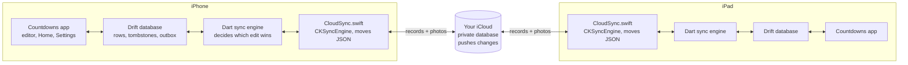
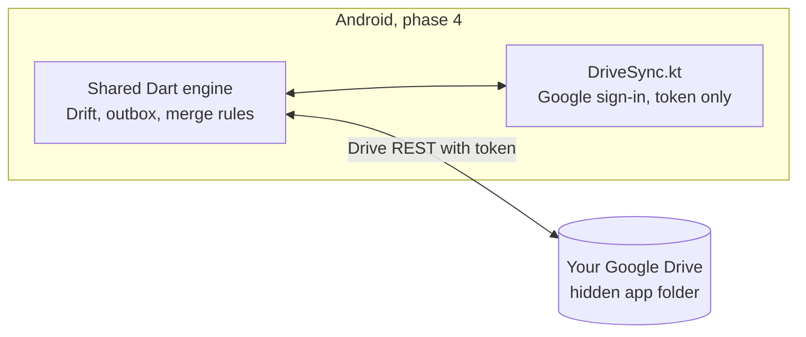
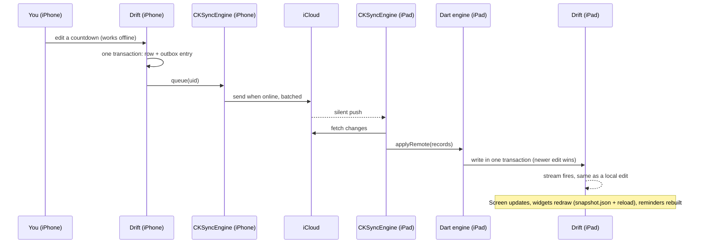
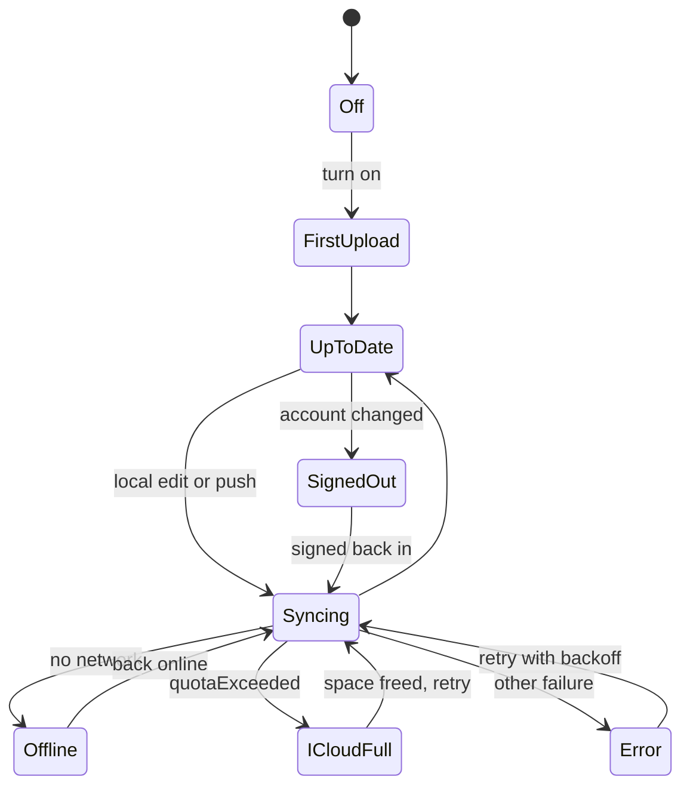

# Device sync plan

Status: plan only, nothing built yet. Written 2026-11-22.

Countdowns can sync between a person's own devices with no server of ours: iCloud on iPhone and iPad, Google Drive's hidden app folder on Android. Countdowns and photos live in the person's own cloud account, so we pay nothing and hold no data.

- **Apple first.** CloudKit's private database through `CKSyncEngine` gives push-driven sync, no sign-in screen, and no setup beyond the iCloud entitlement.
- **Android second.** Google Drive `appDataFolder` works, but needs a Google sign-in and has no push without a server, so it syncs on open, on edit, and on a periodic background job.
- **iPhone to Android is not in v1.** iCloud can't be reached from Android without a server. If it's wanted later, Google Drive on iOS too would do it with no backend, at the cost of a sign-in and slower sync.
- **Dart decides, native carries.** The merge rules live once in Dart next to Drift. Swift and Kotlin only move records to and from the cloud, the same split as the widget bridge.
- **Honest storage.** Apple has no API for how much iCloud space is left, so iOS shows what Countdowns itself uses and says plainly when iCloud is full. Drive can report the account's total and used space.

The groundwork (ids, tombstones, an outbox) ships first on its own and is invisible to users. That makes the sync work itself a smaller, safer change.

UI mockups: [Sync status screens](https://claude.ai/artifact/W2vSvSiKzsttHkRZNBNZJA) (Highlighter theme).

## How it works

Each device keeps its own full database and works offline. The cloud is a mailbox between devices, not the source of truth.

Android has no push without a server, so it syncs on open, after edits, and every 15 minutes. iPhone and Android don't sync with each other in v1.

### One edit's trip

A synced change lands in the same Drift tables a local edit would, so screens and widgets update through code that already exists. Reminders are the one piece that needs a new call.

## Data model changes

Each countdown gets a global id every device agrees on, a delete becomes a marker instead of a row removal, and every write also queues itself for upload. Today `Events.id` is an autoincrement integer, so two devices would both create a countdown number 7.

The local integer id stays. Notification ids, routes (`/event/7`), widget links (`countdowns://event/7`) and widget photo file names all use it, and none of those leave the device. Only the new `uid` crosses the wire.

| Change (Drift schema 3 to 4; schema 2 added `artId`, schema 3 added `kind` for Since) | Why |
| --- | --- |
| `Events.uid` TEXT, unique, UUID v4, backfilled for existing rows | The record name in iCloud and the file name in Drive |
| `Events.modifiedAt` (copied from `updatedAt`) + `modifiedBy` (device id) | Last writer wins, with the device id as tie breaker |
| `Events.deletedAt` nullable | Tombstone: a delete has to travel to other devices too |
| `Events.photoHash` nullable (SHA-256 of the file) | Photos are named by content, so the same photo is one upload |
| New `Outbox` table: `uid`, `kind` (save or delete), `queuedAt` | Written in the same transaction as the edit, so no change is lost |
| `Meta` keys: `sync.engineState`, `sync.driveToken`, `sync.lastSyncAt`, `sync.account`, `sync.deviceId` | Engine bookmarks and which cloud account this data belongs to |

**What goes in a cloud record.** One record per countdown holding every field the editor sets: title, kind (Soon or Since), date, all-day, icon slug, art id, colour, gradient id and direction, font, unit, repeat, photo hash, photo crops JSON, darken, and the reminder offsets as a list. Reminders don't get records of their own, because each device schedules its own notifications from those offsets. Records carry a `schema` number so an older app skips fields it doesn't know instead of dropping them.

**What stays on each device.** Settings (sort, theme, sounds, haptics, notify on end, app icon), recent fonts and photos, and the widget snapshot. The notify switch stays per device so someone can mute their iPad. Syncing default unit and reminders could come later through iCloud key-value storage.

**Deletes.** `deleteCountdown` sets `deletedAt` and clears the row's data instead of deleting it, and every query filters tombstones out. iCloud gets a real record delete, after which the local tombstone can go. Drive keeps a small tombstone file for 90 days, so a phone that was offline for weeks still learns about the delete.

**Conflicts.** Last writer wins per countdown, compared by `modifiedAt` and then `modifiedBy`. One person rarely edits the same countdown on two devices within seconds, so field-by-field merging isn't worth its cost. Two rules on top:

1. A delete beats any edit made before it. An edit made after the delete brings the countdown back, which matches what the person did last.
2. When iCloud rejects a save because the server copy changed (`serverRecordChanged`), Dart compares the two, keeps the newer one, and resends only if the local copy won.

Device clocks can be a little off, which only matters for two edits to the same countdown within that gap. Each device never stamps a time earlier than the newest one it has seen, so its own edits always move forward.

## Photo sync

Photos travel as separate files named by their content hash, and a countdown only points at the hash. Today `PhotoStore.import` copies the pick into `photos/<microseconds>.jpg` and the event saves that relative path. The picker already caps photos at 2400 px and quality 90.

- **One photo, one upload.** The same photo used by three countdowns, or picked on two devices, has one hash and is stored once. New imports are saved as `photos/<sha256>.jpg`. Existing files keep their names; the migration just records their hash.
- **iCloud.** A `Photo` record type whose record name is the hash and whose `image` field is a `CKAsset`. The countdown record holds the hash as a plain string, not a CloudKit reference, so deleting a countdown never deletes a photo another one still uses.
- **Drive.** A `photo-<hash>.jpg` file in `appDataFolder`, uploaded before the countdown file that points at it.
- **Arrives late.** A countdown can land before its photo. It shows in its colour with a small "Photo on its way" note on the detail screen, then switches when the file arrives.
- **Crops just work.** `photoCrops` stores alignment and zoom per shape, not pixels, so the same crop fits every screen size.
- **Cleanup.** After a sync settles, a photo no countdown points at is removed from the cloud. Locally, files in recents are kept.
- **Widgets.** The widget's cropped PNGs are still made on each device by `WidgetSnapshotWriter`. They are never synced.

## Native bridge and sync engine

A new `countdowns/sync` method channel, our own code like `countdowns/widgets`, with no Flutter plugin. Dart owns the data and the merge rules. Swift and Kotlin only move JSON records.

**Dart (`lib/sync/`)**

- `SyncRecord`: the JSON shape of one countdown record.
- `SyncEngine`: reads the `Outbox`, hands records to the bridge, applies incoming changes in one Drift transaction with the conflict rules, then clears confirmed outbox entries.
- `syncStatusProvider`: a Riverpod stream of state (off, syncing, up to date, offline, needs attention) plus pending count and last sync time. The UI watches only this.

**iOS (`ios/Runner/CloudSync.swift`)**

- One `CKSyncEngine` on the private database with a custom zone `Countdowns`. It needs iOS 17, while the Runner still targets iOS 15 (the widget extension is already 17). Either raise the minimum or show sync only on 17+.
- `CKSyncEngine` creates its own push subscription and schedules its own syncs, so iPad hears about an iPhone edit within seconds with no server.
- Entitlements: iCloud with CloudKit, container `iCloud.com.chrisstayte.countdowns`, and Remote notifications. `Runner.entitlements` already has `aps-environment`.
- When the engine asks for the next batch, Swift calls Dart's `recordsFor(uids)`. Fetched changes go to `applyRemote`, and the engine's state blob goes to `saveState`, which Dart stores in `Meta`.
- If a push wakes the app before Dart is ready, Swift appends the changes to `sync-inbox.json` in Application Support, and Dart drains it on start.

**Android (`android/.../sync/DriveSync.kt`)**

- Kotlin only does sign-in: Credential Manager for the Google account and `AuthorizationClient` for the `drive.appdata` scope (non-sensitive per Google, so only basic app verification). It hands Dart a short-lived access token.
- Dart calls the Drive REST API directly: `changes.list` limited to `appDataFolder`, then file get, create and update. One code path, tested in Dart.
- Drive push notifications need a public HTTPS webhook we would have to run, so Android syncs on app open, on resume, a few seconds after an edit, and on a WorkManager job (15 minutes is Android's minimum).

| Channel call | Direction | Purpose |
| --- | --- | --- |
| `start(state)` / `stop()` | Dart to native | Turn sync on with the saved engine state, or off |
| `queue(changes)` | Dart to native | New outbox entries to send |
| `syncNow()` | Dart to native | Pull to refresh and the Sync now button |
| `accountStatus()` | Dart to native | iCloud or Google account available, missing, restricted |
| `storage()` | Dart to native | Bytes this app stores; on Android also the Google quota |
| `recordsFor(uids)` | native to Dart | Build the records the engine is about to send |
| `applyRemote(changes)` | native to Dart | Saved and deleted records from the cloud |
| `sendResult(result)` | native to Dart | Which saves went through, which conflicted, which failed and why |
| `saveState(blob)` / `status(event)` | native to Dart | Engine bookmark, account changes, errors |

## Existing users and widget refresh

Existing users get the new columns silently and keep using the app offline until they turn sync on. Nothing is uploaded without them choosing it.

**Upgrade path**

1. Drift migration 3 to 4 runs at launch inside a transaction: add columns, give every row a `uid`, copy `updatedAt` to `modifiedAt`, hash each photo file into `photoHash`. The Hive backup file stays untouched.
2. Tests in the style of `test/migration_test.dart`: a v3 database with photos, reminders, a Since event and a missing photo file comes out as v4 with nothing lost and every uid unique.
3. After the update, Home shows one dismissible card: "Keep your countdowns on all your devices", with Turn on iCloud sync. Settings has the same switch.

**First sync on a device that already has countdowns**

- Everything local goes up and everything in the cloud comes down. Nothing is replaced.
- People who made "Christmas" by hand on both devices end up with two. After the first sync, countdowns with the same title and date are offered in one sheet: "These look the same on both devices. Keep one?" The newer edit is kept.

**Account changes**

- Signed out of iCloud, or a different Apple ID: sync pauses and the countdowns stay on the device. With a new account, the app asks whether to add this device's countdowns to it.
- Turning sync off keeps everything local. A separate "Remove from iCloud" button deletes the `Countdowns` zone, which frees the space.

**Widgets and notifications after a sync**

`main.dart` already listens to `eventsStreamProvider` and calls `WidgetSnapshotWriter.write`, which writes `snapshot.json` and reloads WidgetKit or Glance. Incoming changes go through the same tables, so widgets update for free. Two gaps to close:

- Notifications are rebuilt only from `EventsController.save` and `deleteEvent`. `applyRemote` must call `rescheduleNotifications()` too, or a reminder changed on iPad won't fire on iPhone.
- A photo that arrives after its countdown doesn't change the row, so the stream doesn't fire. The download marks the countdown with a local `photoReadyAt`, which triggers one more snapshot write.

If iOS wakes the app for a push without starting Flutter, the widget catches up the next time Dart runs. Test this on a real device in the prototype.

## Sync status and storage UI

Sync stays quiet when it works and speaks up only when the person has to do something. Full status lives in a new Sync section in Settings; Home shows a slim banner only for problems.

| State | Settings shows | Home shows |
| --- | --- | --- |
| Off | "Keep countdowns on your iPhone and iPad." + switch | Nothing (one-time intro card after the update) |
| First upload | "Uploading 12 of 40" with a progress bar | Nothing |
| Syncing | "Syncing 2 changes" | Nothing |
| Up to date | "Up to date · 2 min ago" + Sync now | Nothing |
| Offline | "Waiting for a connection. 3 changes are saved on this iPhone." | Nothing |
| iCloud full | "iCloud is full. New changes stay on this iPhone until there's space." | Banner with Free space |
| Signed out | "Sign in to iCloud in Settings to sync." | Banner once, dismissible |
| Restricted | "iCloud is off for Countdowns. Screen Time or your organisation manages this." | Nothing |
| Other error | "Couldn't sync. We'll keep trying." + Try again | Only if it lasts a day |

**What storage can be shown honestly**

- **iOS: what Countdowns uses, not what's left.** CloudKit has no API for a person's total or remaining iCloud space. Apple's guidance for `CKError.quotaExceeded` on the private database is only to prompt the person to manage storage in iCloud settings. So the app shows "Countdowns uses 14.2 MB of your iCloud · 40 countdowns, 12 photos", added up from the records and photos it uploaded.
- **iOS: when it's full, say so.** The first `quotaExceeded` error is the one reliable signal. It turns on the iCloud full state, and the text explains where to look: Settings, then your name, then iCloud. There's no public link to that screen; private `App-Prefs:` URLs risk App Review rejection.
- **Android: the real numbers.** Drive's `about.get` returns the account's storage limit and usage, so Android can draw a true bar: "4.1 GB of 15 GB used · Countdowns 14 MB". The prototype must confirm `about.get` accepts the `drive.appdata` scope alone. With an unlimited plan there's no limit, so show usage only.
- **On this device.** Both platforms can show "On this iPhone: 18 MB" from the database and photos folder.

A countdown record is a few kilobytes and a 2400 px photo at quality 90 is likely around a megabyte (an estimate, to measure in the prototype), so Countdowns should rarely use more than tens of megabytes.

## Rollout

1. **Groundwork, invisible.** Schema 2 with uid, tombstones, outbox, photo hashes, plus the notification and widget fixes. Ships in a normal update with no sync UI.
2. **iCloud sync behind a switch.** `CloudSync.swift`, the Dart engine, the Settings section. TestFlight on two devices first, including airplane mode, a full iCloud account, and sign-out.
3. **Status polish.** Home banners, the duplicate sheet, "Remove from iCloud", storage line.
4. **Android on Google Drive.** Sign-in, Drive REST in Dart, WorkManager job, the storage bar.

## Risks

- **CloudKit schema is permanent in production.** Fields can be added but never removed or retyped once deployed, so review the record shape before the first production deploy.
- **iOS 15 and 16 users.** `CKSyncEngine` needs iOS 17. Raise the app's minimum or hide sync on older versions.
- **Background wake on iOS.** A push may wake the app without Flutter running; the inbox file covers the data, and widgets catch up later.
- **Google verification.** `drive.appdata` is non-sensitive, but the app still needs an OAuth consent screen and basic verification before public release.

## Open decisions

- [ ] Sync on by default for new installs, or opt in?
- [ ] Raise the iOS minimum to 17, or keep 15 and hide sync below 17?
- [ ] Is iPhone to Android sync wanted at all? If yes, Google Drive on iOS too, with no server.

## Sources

- [CKSyncEngine](https://developer.apple.com/documentation/cloudkit/cksyncengine-5sie5) (iOS 17+, automatic push subscription and scheduling)
- [CKError.quotaExceeded](https://developer.apple.com/documentation/cloudkit/ckerror/quotaexceeded)
- [Apple forums: checking quota exceeded in CloudKit](https://developer.apple.com/forums/thread/840348)
- [Google Drive API scopes](https://developers.google.com/workspace/drive/api/guides/api-specific-auth) (`drive.appdata` is non-sensitive)
- [Google Drive push notifications](https://developers.google.com/workspace/drive/api/guides/push) (need an HTTPS webhook)
